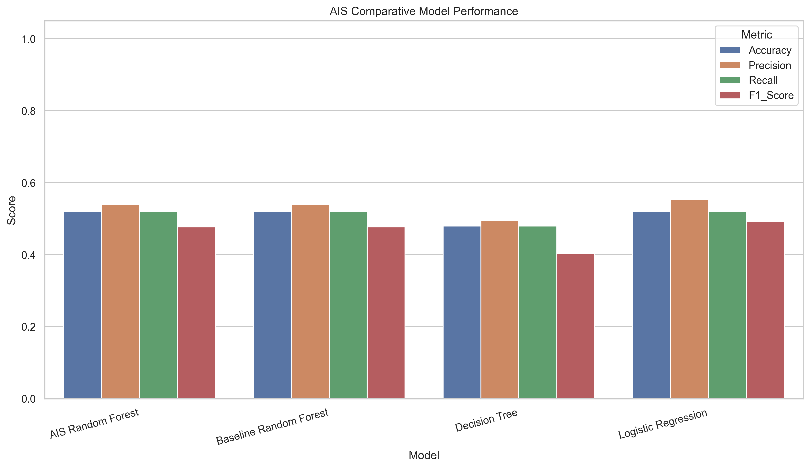
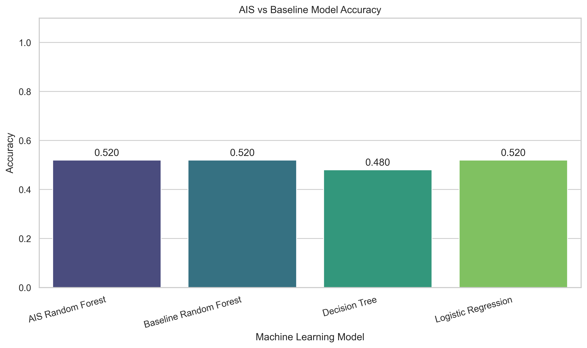
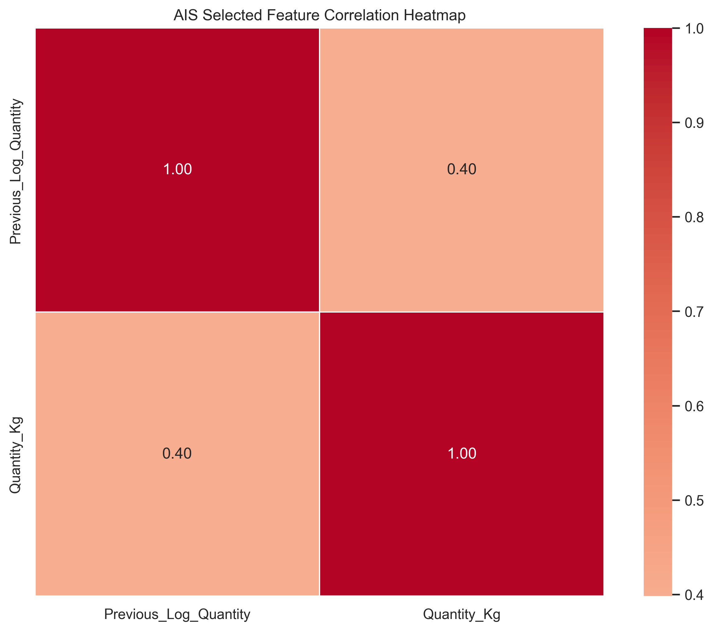
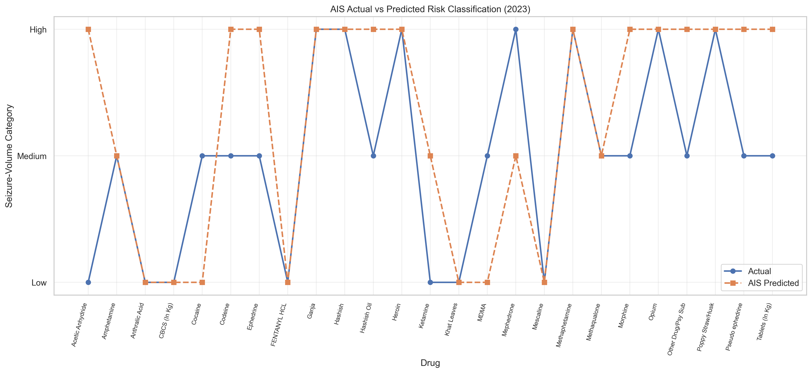
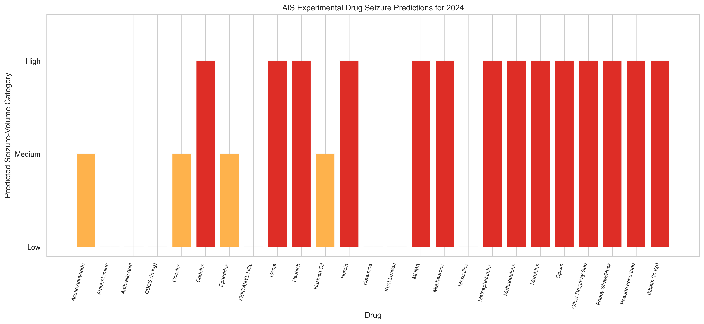
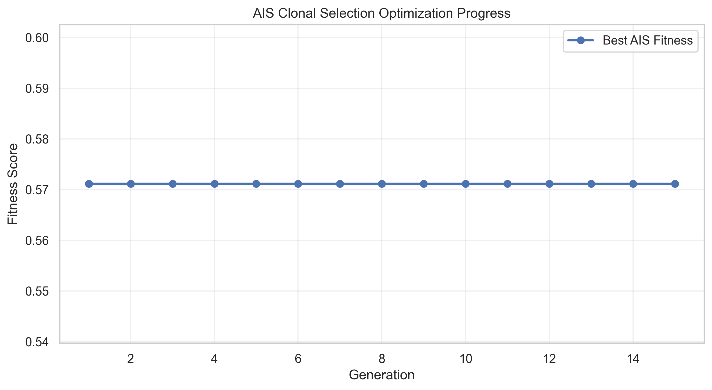
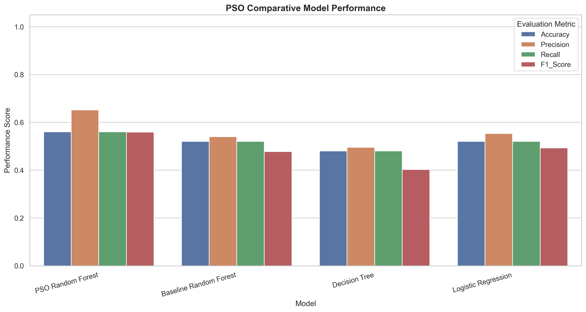
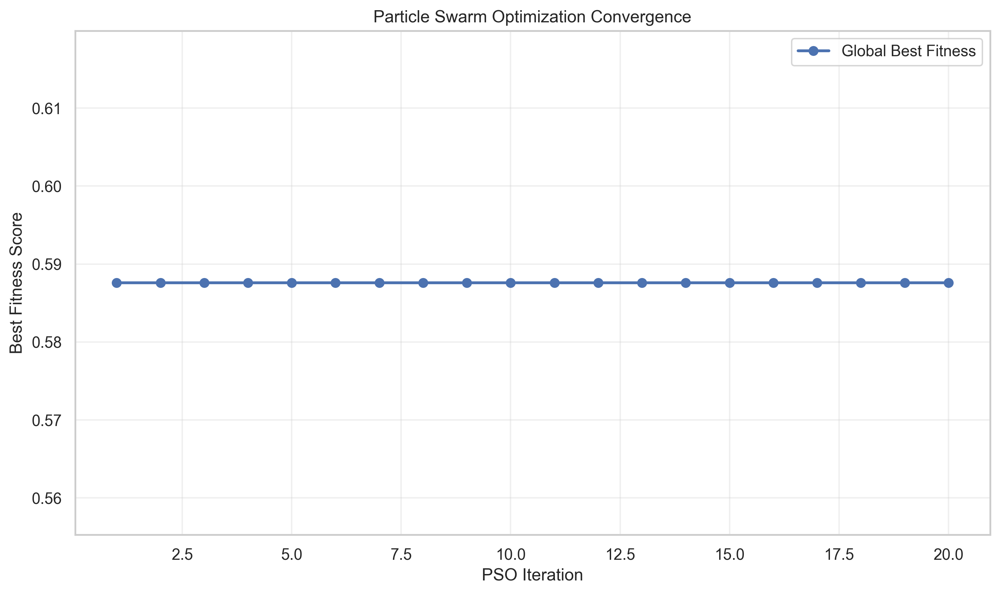
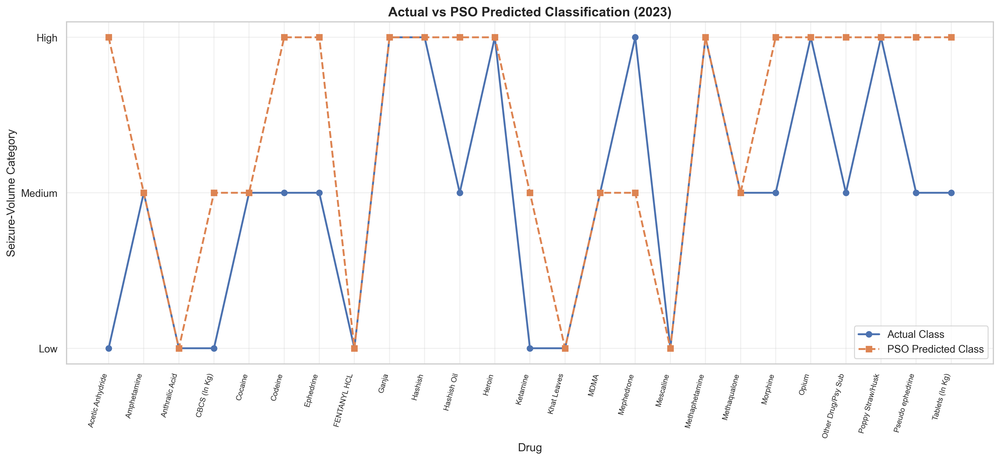
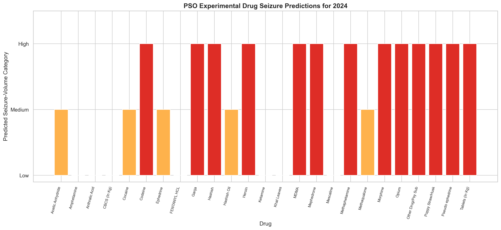

# AI-Based Drug Seizure Trend Analysis and Risk Classification Using Machine Learning

## 📌 Project Overview

The **AI-Based Drug Seizure Trend Analysis and Risk Classification Using Machine Learning** project is designed to analyze historical drug seizure records, identify trends, classify seizure quantities, and explore future seizure-volume patterns using Machine Learning (ML) and optimization algorithms.

The project uses historical drug seizure data from **2019 to 2023** and applies classification algorithms to categorize seizure quantities into **Low, Medium, and High** relative volume classes.

To improve the classification process, two nature-inspired optimization algorithms are implemented:

- **Artificial Immune System (AIS)**
- **Particle Swarm Optimization (PSO)**

These algorithms optimize feature selection and Random Forest hyperparameters to identify potentially better-performing classification models.

The project also generates visualizations, evaluation metrics, classification results, experimental predictions, and saved machine learning models.

> **Note:** The Low, Medium, and High categories describe relative seizure quantities. They do not directly represent crime severity, drug harmfulness, trafficking activity, or public-health risk.

---

## 🎯 Project Objectives

The major objectives of this project are:

1. Analyze historical drug seizure quantities from 2019 to 2023.
2. Identify changes and trends in drug seizure patterns.
3. Preprocess and transform the dataset for machine learning.
4. Classify drug seizure quantities into Low, Medium, and High categories.
5. Implement multiple machine learning classification algorithms.
6. Optimize feature selection using Artificial Immune System (AIS).
7. Optimize Random Forest hyperparameters using Particle Swarm Optimization (PSO).
8. Compare baseline, AIS, and PSO model performance.
9. Generate experimental seizure-volume category predictions for 2024.
10. Visualize classification results, correlations, model accuracy, and optimization progress.
11. Save trained models, evaluation results, and project configurations.

---

## 📊 Dataset Description

### Dataset Name

`RS_Session_266_AU_242_C_iii.csv`

### Dataset Information

| Attribute | Description |
|---|---|
| Dataset Type | Historical drug seizure statistics |
| Time Period | 2019–2023 |
| Original Records | 30 |
| Original Columns | 7 |
| Data Format | CSV |
| Data Category | Numerical and categorical |
| Main Variable | Drug seizure quantity |
| Primary Task | Multiclass classification |
| Experimental Forecast Year | 2024 |

### Dataset Features

The original dataset contains:

- Serial number
- Drug or substance name
- Seizure quantity in 2019
- Seizure quantity in 2020
- Seizure quantity in 2021
- Seizure quantity in 2022
- Seizure quantity in 2023

The dataset includes several substances, such as:

- Heroin
- Cocaine
- Ganja
- Morphine
- MDMA
- Other recorded substances

### Data Preprocessing

The following preprocessing operations are performed:

1. Load the dataset using Pandas.
2. Remove summary and aggregate rows.
3. Separate kilogram-based observations from records measured in other units.
4. Convert yearly seizure quantities into numerical values.
5. Handle missing and invalid observations.
6. Remove duplicate substance records.
7. Convert the dataset from wide format into long format.
8. Create historical lag-based features.
9. Generate relative seizure-volume classification labels.
10. Divide the observations chronologically into training and testing datasets.

The model uses kilogram-based records only to avoid combining incompatible measurement units.

---

## 🧠 Machine Learning Methodology

The project implements a supervised machine learning classification framework.

### Classification Categories

Drug seizure quantities are classified into three categories:

| Class | Category | Description |
|---|---|---|
| 0 | Low | Lower relative seizure quantity |
| 1 | Medium | Moderate relative seizure quantity |
| 2 | High | Higher relative seizure quantity |

The classification thresholds are calculated using the 33rd and 67th percentiles of the training data.

These thresholds are learned without using the final test-year observations.

### Feature Engineering

The following features are generated from historical data:

| Feature | Description |
|---|---|
| Previous_Log_Quantity | Log-transformed previous-year seizure quantity |
| Previous_Log_Change | Logarithmic change between earlier seizure quantities |
| Previous_Growth | Relative change in historical seizure quantities |
| Year | Observation year, used in the baseline ML implementation |

Historical lag features allow the models to classify current-year seizure quantities using previous observations.

### Training and Testing Strategy

| Dataset | Year | Purpose |
|---|---|---|
| Historical features | 2019–2020 | Generate lag-based predictors |
| Training observations | 2021 | Initial model fitting |
| Validation observations | 2022 | AIS and PSO optimization |
| Test observations | 2023 | Final evaluation |
| Experimental predictions | 2024 | Exploratory classification |

For the final 2023 evaluation, the optimized classifiers are fitted using 2021 and 2022 observations.

The 2023 observations are excluded from AIS and PSO optimization.

---

## 🤖 Machine Learning Algorithms

The project implements the following algorithms.

### 1. Random Forest Classifier

Random Forest is an ensemble learning algorithm that combines multiple decision trees to generate classification predictions.

**Advantages:**

- Handles nonlinear relationships.
- Supports feature importance analysis.
- Works with numerical datasets.
- Can reduce the variance of individual decision trees.
- Supports feature selection and hyperparameter optimization.

### 2. Decision Tree Classifier

Decision Tree is a supervised learning algorithm that recursively partitions the feature space.

**Advantages:**

- Easy to understand.
- Provides interpretable decision rules.
- Supports nonlinear classification boundaries.
- Requires relatively little preprocessing.

### 3. Logistic Regression

Logistic Regression is used as a baseline classification algorithm.

**Advantages:**

- Computationally efficient.
- Provides a simple benchmark.
- Supports multiclass classification.
- Useful for comparing more complex algorithms.

### 4. Gradient Boosting Classifier

Gradient Boosting combines multiple weak learners sequentially to improve predictive performance.

**Advantages:**

- Supports nonlinear classification.
- Learns from earlier model errors.
- Can capture interactions between features.
- Provides another benchmark for comparison.

---

## 🧬 Artificial Immune System (AIS)

### Introduction

Artificial Immune System (AIS) is a nature-inspired computational approach based on biological immune-system mechanisms.

AIS algorithms simulate processes such as:

- Antibody generation
- Affinity evaluation
- Clonal selection
- Mutation
- Memory retention
- Population replacement

In this project, a **CLONALG-inspired Artificial Immune System** is used to optimize a Random Forest classifier.

### AIS Optimization Objectives

AIS searches for suitable combinations of:

1. Selected input features
2. Number of Random Forest trees
3. Maximum tree depth
4. Minimum samples per leaf

### AIS Workflow

```text
Initialize Antibody Population
              |
              v
      Evaluate Affinity
              |
              v
      Select Best Antibodies
              |
              v
       Clone Antibodies
              |
              v
       Apply Mutation
              |
              v
     Evaluate New Antibodies
              |
              v
      Update Population
              |
              v
    Repeat for Generations
              |
              v
      Best AIS Solution
              |
              v
  Train Optimized Random Forest
              |
              v
      Evaluate on Test Data
```

### AIS Configuration

| Parameter | Value |
|---|---|
| Optimization Algorithm | CLONALG-inspired AIS |
| Population Size | 12 |
| Generations | 15 |
| Elite Antibodies | 4 |
| Clones per Elite | 4 |
| Random Replacements | 3 |
| Fitness Metric | Macro F1-score |
| Base Classifier | Random Forest |

### AIS Fitness Function

The fitness function evaluates classification performance using macro-averaged F1-score.

A small penalty is applied for selecting additional features.

**Fitness = Macro F1-score − Feature Selection Penalty**

The optimization objective is to maximize classification performance while discouraging unnecessarily complex feature subsets.

---

## 🐦 Particle Swarm Optimization (PSO)

### Introduction

Particle Swarm Optimization (PSO) is a population-based optimization algorithm inspired by collective movement in bird flocks and fish schools.

Each particle represents a candidate solution.

Particles update their positions using:

- Current velocity
- Personal best solution
- Global best solution

### PSO Optimization Objectives

PSO is used to optimize:

1. Feature selection
2. Number of estimators
3. Maximum tree depth
4. Minimum samples per leaf

### PSO Workflow

```text
Initialize Particle Swarm
              |
              v
      Evaluate Fitness
              |
              v
      Update Personal Best
              |
              v
       Update Global Best
              |
              v
       Update Velocity
              |
              v
       Update Position
              |
              v
      Repeat Iterations
              |
              v
       Best PSO Solution
              |
              v
  Train Optimized Random Forest
              |
              v
      Evaluate on Test Data
```

### PSO Configuration

| Parameter | Value |
|---|---|
| Optimization Algorithm | Particle Swarm Optimization |
| Number of Particles | 12 |
| Number of Iterations | 20 |
| Inertia Weight | 0.7 |
| Cognitive Coefficient | 1.5 |
| Social Coefficient | 1.5 |
| Fitness Metric | Macro F1-score |
| Base Classifier | Random Forest |

### PSO Velocity Update

The velocity update equation is:

```text
v(t+1) = w*v(t)
       + c1*r1*(pbest - x(t))
       + c2*r2*(gbest - x(t))
```

Where:

- `v(t)` = Current particle velocity
- `w` = Inertia weight
- `c1` = Cognitive coefficient
- `c2` = Social coefficient
- `r1`, `r2` = Random values
- `pbest` = Personal best position
- `gbest` = Global best position
- `x(t)` = Current particle position

The position update equation is:

```text
x(t+1) = x(t) + v(t+1)
```

PSO searches for a combination of features and Random Forest parameters that improves validation performance.

---

## 📈 Model Evaluation Metrics

The classification models are evaluated using the following metrics.

### Accuracy

Accuracy measures the proportion of correctly classified observations.

```text
Accuracy = (TP + TN) / (TP + TN + FP + FN)
```

### Precision

Precision measures the proportion of predicted positive observations that are correct.

```text
Precision = TP / (TP + FP)
```

### Recall

Recall measures the proportion of actual positive observations that are correctly identified.

```text
Recall = TP / (TP + FN)
```

### F1-Score

F1-score is the harmonic mean of precision and recall.

```text
F1 = 2 * (Precision * Recall)
         / (Precision + Recall)
```

For multiclass classification, the project reports weighted precision, recall, and F1-score.

AIS and PSO optimization use macro F1-score during validation.

### Confusion Matrix

A confusion matrix displays the relationship between actual and predicted classes.

It helps identify classification errors among Low, Medium, and High seizure-volume categories.

---

## 📊 Results and Visualization

The project generates multiple visualizations for analyzing classification performance and historical seizure patterns.

### 1. AIS Model Comparison

The following graph compares the classification performance of the AIS-optimized Random Forest with baseline machine learning algorithms.



**Figure 1: Comparative performance of AIS-optimized and baseline machine learning models.**

The visualization includes:

- Accuracy
- Precision
- Recall
- F1-score

This graph provides a visual comparison of model performance on the 2023 test observations.

The actual performance values are generated during execution and stored in `ais_comparison.csv`.

### 2. AIS Accuracy Comparison



The accuracy graph compares the classification accuracy of:

- AIS Random Forest
- Baseline Random Forest
- Decision Tree
- Logistic Regression

### 3. AIS Correlation Heatmap



The heatmap visualizes relationships between AIS-selected features and seizure quantities.

### 4. AIS Classification Results



The result graph compares actual and predicted seizure-volume classes for 2023.

The corresponding results are stored in:

`ais_result.csv`

### 5. AIS Experimental Predictions



The prediction graph displays experimental seizure-volume category predictions for 2024.

The corresponding predictions are stored in:

`ais_prediction.csv`

These predictions are exploratory and should not be interpreted as verified future seizure quantities.

### 6. AIS Optimization Progress



The optimization graph displays the best fitness score across AIS generations.

### 7. PSO Model Comparison



This graph compares the performance of the PSO-optimized Random Forest against baseline machine learning models.

### 8. PSO Optimization Convergence



The graph shows changes in the global best fitness score during PSO iterations.

### 9. PSO Classification Results



This visualization compares actual and PSO-predicted seizure-volume categories.

### 10. PSO Experimental Predictions



The graph displays experimental PSO-based classifications for 2024.

---

## 🔬 AIS vs PSO Comparative Analysis

The project implements two optimization approaches.

| Feature | AIS | PSO |
|---|---|---|
| Inspiration | Biological immune system | Swarm intelligence |
| Optimization Method | Clonal selection and mutation | Velocity and position updates |
| Feature Selection | Antibody masks | Particle positions |
| Hyperparameter Optimization | Yes | Yes |
| Base Classifier | Random Forest | Random Forest |
| Validation Metric | Macro F1-score | Macro F1-score |
| Final Test Year | 2023 | 2023 |
| Experimental Forecast Year | 2024 | 2024 |
| Model Output | `ais_model.pkl` | `pso_model.pkl` |
| Metrics Output | `ais_metrics.json` | `pso_metrics.json` |

### Comparative Evaluation

The two algorithms can be compared using:

- Classification accuracy
- Weighted precision
- Weighted recall
- Weighted F1-score
- Feature importance
- Optimization convergence
- Model complexity

The best-performing algorithm should be identified from the generated evaluation results.

**No specific accuracy or performance improvement is claimed before running the experiments.**

---

## 📁 Project Directory Structure

```text
AI-Based Drug Seizure Trend Analysis/
│
├── RS_Session_266_AU_242_C_iii.csv
│
├── drug_seizure_analysis.py
├── ais_drug_seizure.py
├── pso_drug_seizure.py
│
├── drug_seizure_model.h5
├── drug_seizure_model.pkl
├── neural_network_preprocessor.pkl
├── model_config.yaml
├── model_metrics.json
│
├── accuracy_graph.png
├── comparison_graph.png
├── heatmap.png
├── result.csv
├── result_graph.png
├── prediction.csv
├── prediction_graph.png
│
├── ais_model.pkl
├── ais_config.yaml
├── ais_metrics.json
│
├── ais_cleaned_dataset.csv
├── ais_long_format.csv
├── ais_accuracy_metrics.csv
├── ais_comparison.csv
├── ais_correlation_matrix.csv
├── ais_result.csv
├── ais_prediction.csv
├── ais_feature_importance.csv
├── ais_optimization_history.csv
│
├── ais_accuracy_graph.png
├── ais_comparison_graph.png
├── ais_heatmap.png
├── ais_result_graph.png
├── ais_prediction_graph.png
├── ais_confusion_matrix.png
├── ais_optimization_graph.png
├── ais_feature_importance_graph.png
│
├── pso_model.pkl
├── pso_config.yaml
├── pso_metrics.json
│
├── pso_cleaned_dataset.csv
├── pso_long_format.csv
├── pso_accuracy_metrics.csv
├── pso_comparison.csv
├── pso_correlation_matrix.csv
├── pso_result.csv
├── pso_prediction.csv
├── pso_feature_importance.csv
├── pso_optimization_history.csv
│
├── pso_accuracy_graph.png
├── pso_comparison_graph.png
├── pso_heatmap.png
├── pso_result_graph.png
├── pso_prediction_graph.png
├── pso_confusion_matrix.png
├── pso_optimization_graph.png
├── pso_feature_importance_graph.png
│
├── requirements.txt
└── README.md
```

---

## 🛠️ Technologies Used

### Programming Language

- Python 3.10+

### Libraries and Frameworks

| Library | Purpose |
|---|---|
| NumPy | Numerical computations |
| Pandas | Dataset preprocessing and analysis |
| Scikit-learn | Machine learning algorithms |
| TensorFlow / Keras | Neural network modeling |
| Matplotlib | Data visualization |
| Seaborn | Statistical visualization |
| Joblib | Model serialization |
| PyYAML | YAML configuration files |
| JSON | Model evaluation reports |
| H5Py | HDF5 file support |

### Development Tools

- Jupyter Notebook
- Visual Studio Code
- Python
- Git
- GitHub

---

## ⚙️ Installation and Setup

### Step 1: Clone the Repository

```bash
git clone https://github.com/YOUR_USERNAME/YOUR_REPOSITORY.git
```

Replace `YOUR_USERNAME` and `YOUR_REPOSITORY` with your actual GitHub repository details.

### Step 2: Navigate to the Project Folder

```bash
cd YOUR_REPOSITORY
```

### Step 3: Create a Virtual Environment

```bash
python -m venv venv
```

### Step 4: Activate the Virtual Environment

**Windows:**

```bash
venv\Scripts\activate
```

**Linux / macOS:**

```bash
source venv/bin/activate
```

### Step 5: Install Dependencies

```bash
pip install numpy pandas scikit-learn tensorflow matplotlib seaborn joblib pyyaml h5py
```

Alternatively, if a `requirements.txt` file is available:

```bash
pip install -r requirements.txt
```

---

## ▶️ How to Run the Project

### Step 1: Configure the Dataset Path

Update the `BASE_DIR` variable in each Python script.

```python
from pathlib import Path

BASE_DIR = Path(
    r"C:\Users\sagni\Downloads\AI-Based Drug Seizure Trend Analysis and Risk Classification Using Machine Learning"
)

CSV_PATH = BASE_DIR / "RS_Session_266_AU_242_C_iii.csv"
```

### Step 2: Run the Baseline Machine Learning Model

```bash
python drug_seizure_analysis.py
```

This generates the baseline model, metrics, and visualizations.

### Step 3: Run AIS Optimization

```bash
python ais_drug_seizure.py
```

This generates all AIS-related results using the `ais_` prefix.

### Step 4: Run PSO Optimization

```bash
python pso_drug_seizure.py
```

This generates all PSO-related results using the `pso_` prefix.

### Step 5: View the Results

After successful execution, open the project folder to access:

- Trained models
- Classification results
- Prediction CSV files
- Accuracy graphs
- Comparison graphs
- Correlation heatmaps
- Optimization convergence graphs
- JSON metrics
- YAML configuration files

All graphs are displayed during execution and saved as PNG files.

---

## 💾 Model Saving and Loading

### Load the Baseline Model

```python
import joblib

model_data = joblib.load("drug_seizure_model.pkl")

model = model_data["pipeline"]
```

### Load the Neural Network Model

```python
from tensorflow.keras.models import load_model

model = load_model(
    "drug_seizure_model.h5",
    compile=False
)
```

The neural network requires the same preprocessing scaler used during training.

### Load the AIS Model

```python
import joblib

ais_data = joblib.load("ais_model.pkl")

ais_model = ais_data["model"]

selected_features = ais_data["selected_features"]

print("AIS Selected Features:", selected_features)
```

### Load the PSO Model

```python
import joblib

pso_data = joblib.load("pso_model.pkl")

pso_model = pso_data["model"]

selected_features = pso_data["selected_features"]

print("PSO Selected Features:", selected_features)
```

Only load serialized model files from trusted sources.

---

## 📉 Historical Trend Analysis

The project analyzes historical drug seizure patterns from 2019 to 2023.

The trend analysis helps examine:

- Yearly changes in recorded seizure quantities
- Differences between substances
- Large increases or decreases in seizure volumes
- Historical variation across reporting years
- Potentially unusual observations

These patterns may reflect changes in reporting, enforcement activity, trafficking, or other factors.

Therefore, seizure quantities alone should not be interpreted as direct measurements of drug consumption or trafficking prevalence.

---

## 🔮 Experimental Prediction System

The project includes an experimental classification framework for 2024.

### Prediction Process

1. Extract historical seizure quantities for 2022 and 2023.
2. Calculate lag-based features.
3. Load the trained classification model.
4. Predict relative seizure-volume categories.
5. Generate prediction probabilities.
6. Save prediction results to CSV.
7. Generate prediction graphs.

### Prediction Output

The output includes:

| Column | Description |
|---|---|
| Drug | Substance name |
| Year | Experimental prediction year |
| Previous_Quantity | Historical seizure quantity |
| Predicted_Class | Predicted class identifier |
| Predicted_Risk | Low, Medium, or High |
| Confidence | Highest model-reported class probability |
| Forecast_Type | Description of experimental prediction |

The model probabilities are not independently calibrated confidence estimates.

The system predicts relative categories rather than exact future seizure quantities.

---

## ⚠️ Limitations

The project has several important limitations.

### 1. Small Dataset

The dataset contains only five years of historical observations.

This limits the ability to learn reliable long-term trends.

### 2. Limited Training Observations

The machine learning models are trained using a relatively small number of substance-year records.

Model performance may vary considerably with additional data.

### 3. Class Definition

The Low, Medium, and High classes are generated using training-data quantiles.

They are not externally validated criminal-risk categories.

### 4. Forecasting Reliability

Experimental predictions for 2024 are not validated against actual 2024 observations.

### 5. Optimization Overfitting

AIS and PSO may overfit the small validation dataset.

An improvement in validation performance does not guarantee better performance on unseen data.

### 6. Reporting and Measurement Differences

Historical seizure records may be influenced by reporting practices, enforcement activity, and measurement conventions.

### 7. Limited External Variables

The current models do not include geographical, socioeconomic, enforcement, or trafficking-network information.

---

## 🚀 Future Enhancements

Potential future improvements include:

1. Integrating larger multi-year datasets.
2. Adding state-wise and district-wise seizure statistics.
3. Developing time-series forecasting models.
4. Implementing LSTM and GRU architectures when sufficient data becomes available.
5. Adding explainable AI methods such as SHAP.
6. Comparing AIS and PSO with Genetic Algorithms.
7. Implementing robust rolling-origin time-series validation.
8. Adding uncertainty estimation and probability calibration.
9. Creating interactive dashboards using Streamlit or Plotly.
10. Developing a web application for exploring historical seizure trends.
11. Incorporating additional contextual variables.
12. Adding automated model evaluation reports.

---

## 🌍 Potential Applications

The project can support:

- Academic research
- Machine learning experimentation
- Historical seizure data analysis
- Statistical trend visualization
- Algorithm optimization studies
- Publicly available data exploration
- Comparative studies of AIS and PSO
- Educational demonstrations of predictive analytics

The models should not be used as standalone tools for operational law-enforcement decisions.

---

## 📌 Key Project Highlights

- Historical drug seizure analysis from 2019 to 2023
- Multiclass seizure-volume classification
- Random Forest, Decision Tree, Logistic Regression, and Gradient Boosting
- Artificial Immune System optimization
- Particle Swarm Optimization
- Feature selection and hyperparameter tuning
- Chronological model evaluation
- Accuracy, precision, recall, and F1-score comparisons
- Correlation heatmaps and confusion matrices
- Experimental 2024 classification predictions
- Automated CSV and PNG generation
- Saved PKL, H5, YAML, and JSON files
- Reproducible Python implementation

---

## 📝 Conclusion

The **AI-Based Drug Seizure Trend Analysis and Risk Classification Using Machine Learning** project demonstrates how machine learning and nature-inspired optimization algorithms can be applied to historical seizure statistics.

The project combines conventional classification models with Artificial Immune System (AIS) and Particle Swarm Optimization (PSO) techniques.

AIS uses clonal selection and mutation to explore feature subsets and Random Forest parameters, while PSO uses swarm-based optimization to search for suitable model configurations.

The generated evaluation reports and visualizations support comparison of these approaches.

The project also demonstrates the importance of data preprocessing, chronological validation, feature engineering, model evaluation, and responsible interpretation of predictions.

Because the available dataset is small, the results should be considered exploratory rather than operationally validated.

---

## 👨‍💻 Author

**Project:** AI-Based Drug Seizure Trend Analysis and Risk Classification Using Machine Learning

**Domain:** Artificial Intelligence, Machine Learning, Data Analytics

**Techniques:** Random Forest, Artificial Immune System, Particle Swarm Optimization

**Programming Language:** Python

---

## 📜 License

This project is intended for educational and research purposes.

Add an appropriate `LICENSE` file if you intend to distribute the project under an open-source license.

---

## ⭐ Support

If you find this project useful, consider starring the repository on GitHub.

Contributions, suggestions, and improvements are welcome.

---

**Developed using Python, Machine Learning, Artificial Immune System, and Particle Swarm Optimization.**
